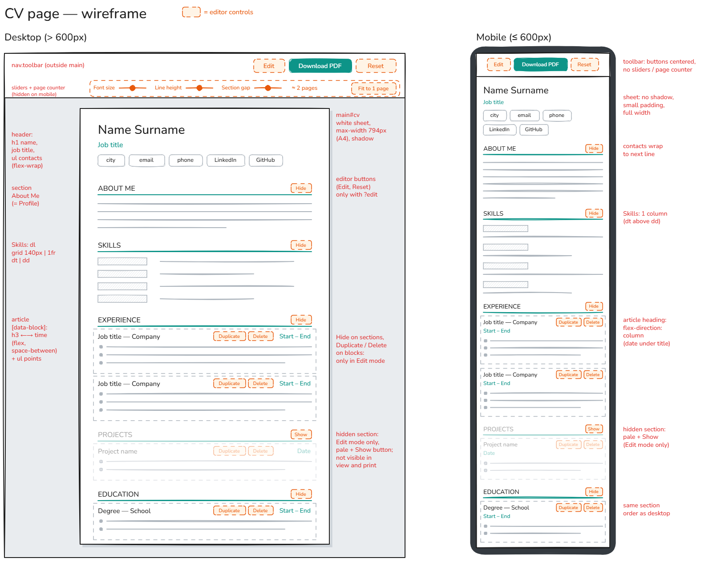

# CV Page

A responsive CV web page built with HTML and CSS.

Live website: https://alakhmakova.github.io/cv-page/

## Files

| File | Purpose |
| --- | --- |
| `index.html` | CV content in semantic HTML |
| `style.css` | All styles: layout, responsive design, print |
| `assets/wireframe.png` | Wireframe for desktop and mobile |

## Wireframe



## CSS notes

### `box-sizing: border-box`

```css
*,
*::before,
*::after {
  box-sizing: border-box;
}
```

This rule changes how the browser calculates the size of an element.

By default (`content-box`), `width` is the width of the content only. Padding and border are **added on top**:

```
width: 300px; padding: 20px; border: 2px
-> real width = 300 + 20 + 20 + 2 + 2 = 344px
```

With `border-box`, `width` is the width of the whole box. Padding and border fit **inside** it:

```
width: 300px; padding: 20px; border: 2px
-> real width = 300px (256px left for the content)
```

Why it matters here: the CV sheet has `max-width: 794px` (the width of an A4 page) and 57px padding on the left and right. With `border-box` the sheet is exactly 794px wide and the text inside is about 680px wide, the same as on a printed A4 page with 15mm margins. Without this rule the sheet would be 794 + 57 + 57 = 908px wide. On a phone, an element with `width: 100%` and padding would also overflow the screen and cause horizontal scrolling.

Selectors:

- `*` selects every element on the page.
- `*::before` and `*::after` select pseudo-elements that CSS can add before and after an element's content. `*` does not include them, so they are listed separately.

### Adjacent sibling selector `+`

```css
#cv article + article {
  margin-top: 12px;
}
```

`A + B` selects an element B that comes **directly after** an element A, when both have the same parent.

- `#cv` limits the rule to the CV sheet.
- `article + article` selects an `article` that has another `article` right before it.

Example: three jobs in the Experience section:

```html
<h2>Experience</h2>
<article>Job 1</article> <!-- not selected: the element before it is h2 -->
<article>Job 2</article> <!-- selected: the element before it is article -->
<article>Job 3</article> <!-- selected: the element before it is article -->
```

So the 12px margin is added **between** entries, but not above the first one. The first entry stays close to the section heading, and the next entries are separated by 12px.

A plain `article { margin-top: 12px; }` would also add the margin above the first entry and leave an extra gap under the section heading.
